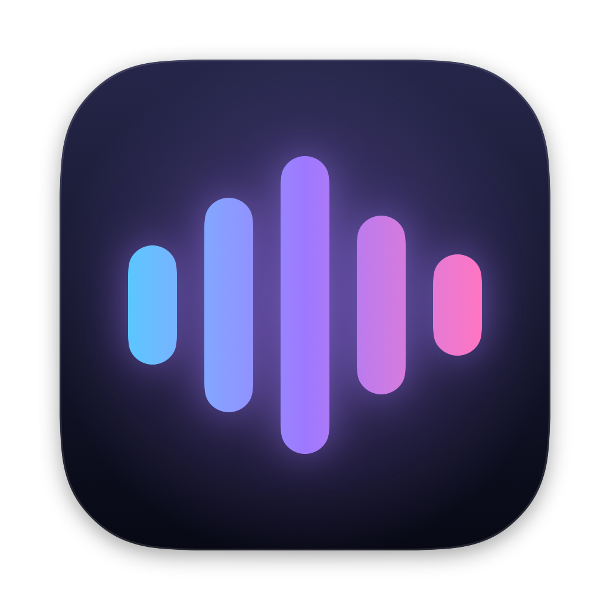

<p align="center"></p>

# Holos

Офлайн-диктування для macOS — за замовчуванням українською, але можна вибрати будь-яку зі 100 мов Whisper або автовизначення. Затисніть клавішу, скажіть фразу, відпустіть — текст з'явиться там, де стоїть курсор. Розпізнавання виконує [whisper.cpp](https://github.com/ggml-org/whisper.cpp) прямо на вашому Mac: аудіо не залишає комп'ютер і не записується на диск.

*Offline push-to-talk dictation for macOS (Ukrainian by default; any of Whisper's 100 languages or auto-detect). Speech recognition runs locally via whisper.cpp — no audio ever leaves the machine.*

## Можливості

- **Push-to-talk** на правому ⌥ Option (або правому ⌘, правому ⌃, fn)
- **Без утримання**: двічі натиснути клавішу — говорити скільки треба, ще раз натиснути — вставити
- **Вставка в будь-яку програму** — туди, де курсор, з пробілом там, де він потрібен
- **Вибір мови**: українська за замовчуванням, будь-яка зі 100 мов Whisper або автовизначення
- **Мікрофон, мова й клавіша — прямо в меню** рядка меню, без вікна налаштувань
- **Bluetooth-мікрофон — в останню чергу**: навушники не перемикаються в режим гарнітури, якщо є дротовий мікрофон
- **Записи**: останні 5 продиктованих текстів у меню — скопіювати або вставити будь-який, не лише останній
- **Анімація внизу екрана**: запис → розпізнавання → готово (або червоний хрестик, якщо мікрофон не спрацював)
- **Підказка** для імен і термінів і **заміни** для слів, які модель усе одно пише не так
- **Експериментальний рушій Parakeet** (NVIDIA) — розпізнає в 10–14 разів швидше за whisper
- **Детектор мовлення Silero VAD** — на тиші й шумі нічого не вигадує
- **Перезапуск після збою** і журнал у системному журналі macOS
- **Жодного мережевого коду** в застосунку

## Вимоги

- Mac на Apple Silicon (M1 і новіші)
- macOS 14 або новіша
- Xcode зі Swift 5.10 або новішим
- Близько 1,5 ГБ вільного місця; інтернет — лише для першого завантаження залежностей і моделі

Перевірено на macOS 27.0.1, M1 Max, Xcode 26.6. На старіших версіях macOS не перевірялося.

## Встановлення

```bash
git clone https://github.com/ololower/holos.git Holos
cd Holos
scripts/fetch-deps.sh        # whisper.cpp і Silero VAD (58 МБ), з перевіркою SHA-256
scripts/download-model.sh    # модель розпізнавання (1,1 ГБ)
scripts/setup-signing.sh     # рекомендовано: постійний локальний підпис, див. «Підпис і дозволи»
scripts/build.sh --install   # збирає, копіює в /Applications і запускає
```

Після запуску в рядку меню з'явиться іконка Holos і відкриються налаштування. Надайте два дозволи:

1. **Мікрофон** — підтвердіть у системному вікні.
2. **Універсальний доступ** — Системні параметри → Приватність і безпека → Універсальний доступ → увімкніть Holos. Потрібен, щоб чути клавішу в будь-якій програмі й вставляти текст.

Статус дозволів у налаштуваннях оновлюється сам, перезапуск не потрібен.

## Оновлення

```bash
scripts/update.sh
```

Скрипт показує, що змінилося, підтягує нову версію з GitHub, за потреби оновлює залежності, перезбирає й перезапускає Holos. Якщо оновлень немає, нічого не робить. Дозволи після оновлення зберігаються, якщо налаштовано підпис (`scripts/setup-signing.sh`).

Сам застосунок оновлень не перевіряє й до мережі не звертається — оновлюєтеся лише тоді, коли запускаєте скрипт.

## Використання

| Дія | Як |
|---|---|
| Диктувати | тримати правий ⌥, говорити, відпустити |
| Диктувати без утримання | двічі коротко натиснути правий ⌥, говорити (до 3 хв), натиснути ще раз |
| Скасувати запис | Esc (під час утримання — будь-яка інша клавіша) |
| Скопіювати недавній текст | меню Holos → «Записи» → клацнути потрібний (останні 5) |
| Вставити недавній текст | те саме з затиснутим ⌥ — текст вставиться там, де курсор, як після диктування |
| Мікрофон, мова, клавіша | меню Holos → «Мікрофон», «Мова», «Клавіша» |
| Решта налаштувань | меню Holos → «Налаштування…» (вкладки «Загальні», «Мікрофон», «Розпізнавання», «Заміни», «Експериментальне») |

Під час запису без утримання в пігулці замість червоної крапки — квадратик «стоп»: клавішу відпущено, наступне натискання завершить запис. Інші клавіші тоді не заважають — можна перемикатися між вікнами. Вимкнути: меню Holos → «Клавіша» → «Двічі натиснути — запис без утримання».

Якщо запис не вдався (мікрофон від'єднано, зайнятий, не передає звук або передає лише тишу), пігулка внизу екрана покаже червоний хрестик, а причина буде вгорі меню Holos.

### Який мікрофон береться

- **Вибраний** у меню «Мікрофон» — завжди, якщо під'єднаний, навіть Bluetooth: його вибрали явно.
- **«Автоматично»** або коли вибраний від'єднано — спершу дротовий (USB, вбудований, Thunderbolt), потім Bluetooth та інші бездротові (iPhone). У кожній групі першим іде системний за замовчуванням. Bluetooth-мікрофон в останню чергу, бо щойно його відкрити, навушники перемикаються в режим гарнітури: звук у них стає моно й помітно гіршим.
- **Вбудований при закритій кришці** пропускається: він записує лише тишу.
- Віртуальні пристрої (Zoom, Teams, BlackHole) автоматично не беруться — лише якщо вибрати їх явно.

У меню видно, який мікрофон буде насправді: «Автоматично — HATOR Signify», «HATOR Signify (від'єднаний, зараз — MacBook Pro Microphone)».

### Гучність мікрофона в Holos

Налаштування → «Мікрофон» → «Гучність … у Holos»: підсилення від −12 до +24 дБ, окремо для кожного мікрофона.

- Системна гучність входу в macOS одна на весь пристрій, окремої для програми немає. Тому Holos підсилює чи приглушує звук сам, уже після запису: системна гучність і інші програми (наприклад, Zoom під час дзвінка) не змінюються.
- Для USB- і вбудованих мікрофонів це практично те саме, що системний повзунок: там він теж цифровий. Якщо ж мікрофон перевантажується вже на вході (смужка в червоній зоні навіть із 0 дБ), зменшувати треба системну гучність — після запису спотворення не прибрати.
- «Перевірити» слухає мікрофон 5 с із поточним підсиленням, показує рівень і каже, чи гучності досить. Записаний звук ніде не зберігається.

### Експериментальне

Налаштування → «Експериментальне»: прискорення, ще не перевірені в щоденній роботі. Усе вимкнено за замовчуванням.

| Налаштування | Якість | Що дає (M1 Max, large-v3, синтетичний голос) |
|---|---|---|
| Прогрівати модель після запуску | не впливає | після оновлення Holos чи перезавантаження Mac перше розпізнавання швидше на 0,2–0,8 с; в інших випадках різниці немає |
| Тримати мікрофон відкритим 10 с після диктування | не впливає | наступне диктування без ~0,2 с на відкриття мікрофона; весь цей час світиться помаранчевий індикатор |
| Швидше розпізнавати довгі фрази | може погіршити | фрази довші за 8 с — жадібне декодування замість beam search: на 14 с на 15–25 % швидше, текст у тесті той самий |
| Без повторних спроб розпізнавання | може погіршити | страховка від рідкісних зависань на кілька секунд; у тестах повтори не знадобилися жодного разу |
| Рушій розпізнавання: Parakeet | може погіршити | у 10–14 разів швидше; див. «Моделі» → «Parakeet» |

Чого навмисно немає. Урізане вікно енкодера (`audio_ctx`) на довгих фразах удвічі пришвидшує енкодер, але на коротких large-v3 видає нісенітницю й зависає на 14–27 с. Ще перевірялося, чи сповільнює розпізнавання 3-хвилинний простій відеоядра: заміри показали, що ні.

### Пробіли навколо тексту

Holos через Accessibility дивиться на символ перед курсором і після нього: пробіл перед текстом ставиться, лише якщо курсор стоїть одразу після слова чи розділового знака, а після тексту — лише якщо впритул далі йде слово. Деякі програми (частина Electron-застосунків, термінали) цього не повідомляють — тоді, як і раніше, пробіл додається після тексту.

### Підказка для розпізнавання

Whisper — модель розпізнавання, а не чат: інструкцій вона не виконує, системного промпту в неї немає. Підказка подається їй як «попередня репліка», і модель підлаштовує під неї написання слів і стиль.

- Пишіть слова в потрібному написанні: `Олексій Коваленко, PhpStorm, GitHub, пулреквест.`
- Пишіть акуратно, з великими літерами й розділовими знаками — модель копіює стиль підказки. Підказка дрібними літерами без ком дасть такий самий текст.
- Інструкції на кшталт «пиши без ком» не працюють.
- До ~50 слів: модель бере не більше 223 токенів (українське слово — близько 4 токенів), довший текст обрізається з початку.
- Лише слова, які ви справді вживаєте: на нечіткому звуці модель може вставити слово з підказки, якого ви не казали.

Що саме отримує модель (мова, підказка, параметри декодування, VAD), показано в налаштуваннях у блоці «Що саме отримує модель».

### Заміни

Коли модель і з підказкою пише слово не так, допоможуть заміни: Налаштування → «Заміни». Це таблиця, як «Заміна тексту» в налаштуваннях клавіатури macOS: **+** додає рядок, **−** видаляє вибрані.

| Модель пише | Замінити на |
|---|---|
| пі ейч пі шторм | PhpStorm |
| кубер | Kubernetes |
| ну | *(порожньо — прибрати)* |

- Сама модель про заміни не знає (на відміну від підказки): Holos шукає фрази з лівої колонки в уже розпізнаному тексті й ставить замість них праву.
- Регістр у лівій колонці не важить; замінюється лише ціле слово чи фраза: правило для «кубер» не зачепить «кубернетис».
- Порожня права колонка прибирає фразу разом із зайвими комами («відкрий, ну, файл» → «відкрий, файл»).
- Під таблицею — «Перевірка»: напишіть фразу так, як її розпізнала модель, і одразу побачите результат.
- Без інтерфейсу: `build/Holos.app/Contents/MacOS/Holos --postprocess "текст" --rules $'кубер > Kubernetes\nну >'` (правило на рядок, «що > на що»).

## Моделі

Моделі лежать у `~/Library/Application Support/Holos/models/` і вибираються в Налаштування → «Розпізнавання» → «Модель»; «Інша…» — модель з іншого місця.

| Модель | Команда | Розмір | Примітка |
|---|---|---|---|
| `ggml-large-v3-q5_0.bin` | `scripts/download-model.sh` | 1,1 ГБ | за замовчуванням, точніша для української |
| `ggml-large-v3-turbo-q8_0.bin` | `scripts/download-model.sh turbo` | 0,9 ГБ | приблизно вдвічі швидша, помиляється частіше |

На M1 Max фраза в 10 секунд розпізнається приблизно за 2 с (`large-v3`) або 1 с (`turbo`). Перше завантаження моделі після встановлення може тривати до ~20 с — Metal компілює шейдери, далі менше секунди. Інші моделі: [huggingface.co/ggerganov/whisper.cpp](https://huggingface.co/ggerganov/whisper.cpp).

### Parakeet (експериментально)

Другий рушій — NVIDIA Parakeet TDT 0.6B v3 у Core ML (розпізнавання на Neural Engine). Після завантаження модель з'являється в Налаштування → «Розпізнавання» → «Модель» поруч із whisper: вибір моделі Parakeet сам перемикає рушій. Те саме — «Експериментальне» → «Рушій розпізнавання».

| Модель | Команда | Розмір | Примітка |
|---|---|---|---|
| `parakeet-ultra-coreml` | `scripts/download-model.sh parakeet-ultra` | 0,6 ГБ | рекомендовано: донавчена v3, точніша на всіх 24 мовах FLEURS |
| `parakeet-tdt-0.6b-v3-coreml` | `scripts/download-model.sh parakeet-v3` | 0,6 ГБ | оригінальна v3 від NVIDIA; на коротких українських фразах у тестах помітно гірша за ultra |

Заміри на M1 Max (синтетичний голос Lesya):

| | фраза 4 с | фраза 14 с | фраза 27 с |
|---|---|---|---|
| whisper large-v3 | 1,3 с | 2,4 с | 4,5 с |
| Parakeet ultra | 0,13 с | 0,17 с | 0,33 с |

Чим відрізняється від whisper:

- **Мову визначає сам** (25 європейських мов, серед них українська й англійська). На коротких фразах може з'їхати в російську («Привет… и перевер… на проде»). Тому, коли вибрано українську, Holos не дає йому писати ы, э, ъ, ё, а з кількох близьких варіантів віддає перевагу тим, що з і, ї, є, ґ: так «и перевер… на проде» стає «і перевір… на проді», а правильні «де», «ви», «дим» не чіпаються. Для англійської й інших мов з латиницею заборонено кирилицю.
- **Підказки не використовує**: перевірено, що декодер Parakeet на неї не зважає. Для термінів працюють заміни.
- **Розділові знаки й великі літери** ставить сам, але речення частіше з'єднує комою.
- **Перший запуск** після завантаження моделі — до 20 с: macOS компілює її для Neural Engine. Далі модель вантажиться за 0,1 с.
- Записи, довші за 15 с, Holos ріже в паузах і розпізнає частинами.

Моделі — Core ML-конвертації від [FluidInference](https://huggingface.co/FluidInference). Логіку декодування Holos повторює за [FluidAudio](https://github.com/FluidInference/FluidAudio), але без цієї бібліотеки: у ній є мережевий код, а в Holos його немає.

## Приватність

- Ні `Holos`, ні `whisper.framework` не імпортують мережевих функцій. Перевірити самостійно:
  ```bash
  nm -u /Applications/Holos.app/Contents/MacOS/Holos | grep -i -E 'socket|connect|NSURLSession'   # порожньо
  lsof -nP -a -p "$(pgrep -x Holos)" -i                                                           # з'єднань немає
  ```
- Інтернет потрібен лише скриптам `fetch-deps.sh` і `download-model.sh`, які ви запускаєте самі.

**Що зберігається і де:**

| Що | Де | Скільки |
|---|---|---|
| Аудіо | лише в пам'яті | до кінця розпізнавання; на диск не пишеться ніколи |
| Розпізнаний текст | лише в пам'яті («Записи», 5 останніх) | до виходу з Holos або «Очистити» |
| Текст під час вставки | буфер обміну | ~0,5 с, потім повертається попередній вміст |
| Налаштування, підказка, заміни | `~/Library/Preferences/local.holos.plist` | постійно |
| Позначка «Holos працює» | `~/Library/Application Support/Holos/running` | поки працює; лише PID і час |
| Журнал | системний журнал macOS | кілька днів; без тексту й аудіо — лише тривалість, кількість символів, мікрофон, помилки |

- Текст у буфері обміну позначено як тимчасовий, тож менеджери буфера (Raycast, Maccy, Paste) не зберігають його в історії, і як «лише для цього Mac» — Universal Clipboard не передає його на iPhone чи інший Mac.
- Коли ви самі копіюєте запис із меню «Записи», це звичайне копіювання — його бачать і менеджери буфера.
- Текст, вставлений у програму, далі зберігає вже вона (як і набраний вручну).
- Між диктуваннями мікрофон закритий. Якщо ввімкнути «Тримати мікрофон відкритим 10 с після диктування», звук за ці секунди навіть не обробляється — лише світиться помаранчевий індикатор.

## Збої й діагностика

**Перезапуск після збою.** Holos ставить агент `~/Library/LaunchAgents/local.holos.watchdog.plist`, який раз на 10 с перевіряє, чи Holos не впав, і за потреби запускає його знову. Після такого перезапуску вгорі меню написано «Holos перезапустився після збою». Звичайний вихід через меню перезапуску не викликає. Якщо Holos падає раніше, ніж за хвилину після запуску, його не перезапускають, щоб не зациклитися. Вимкнути: Налаштування → «Перезапускати після збою». Працює для копії в `/Applications` (`scripts/build.sh --install`). Під час першого встановлення macOS покаже сповіщення про новий фоновий об'єкт.

**Журнал.** Holos пише в системний журнал macOS (без тексту й аудіо):

```bash
/usr/bin/log show --last 1h --info --predicate 'subsystem == "local.holos"'
```

У zsh саме `/usr/bin/log`: просто `log` — це вбудована команда оболонки.

**Версія.** Внизу меню Holos — «Версія 1.0 · 90df73d»: коміт, з якого зібрано застосунок (`-dirty` — з незакоміченими змінами).

**Звіти про збої:** `~/Library/Logs/DiagnosticReports/Holos-*.ips`.

## Підпис і дозволи

macOS прив'язує дозволи (мікрофон, універсальний доступ) до підпису застосунку.

`scripts/setup-signing.sh` один раз створює у вашій login-keychain self-signed сертифікат «Holos Local Signing», і `build.sh` підписує ним. Тоді macOS упізнає Holos за сертифікатом, і дозволи переживають перезбирання. Сертифікат локальний: кожен розробник створює свій. Видалити: Keychain Access → login → «Holos Local Signing» → Delete.

Без сертифіката збірка підписується ad-hoc, і після кожного перезбирання macOS вважає застосунок новим: старий увімкнений дозвіл на нову збірку не діє. Скинути такі «завислі» дозволи:

```bash
tccutil reset Accessibility local.holos
tccutil reset Microphone local.holos
```

## Розробка

```
Sources/Holos/
  AppDelegate.swift        клавіша → запис → розпізнавання → вставка; рядок меню й «Записи»
  HotkeyMonitor.swift      клавіша-модифікатор: утримання, подвійне натискання, скасування
  AudioRecorder.swift      мікрофон (AVCaptureSession) → 16 кГц моно в пам'яті
  AudioDevices.swift       мікрофони (CoreAudio) і черга вибору: дротовий раніше за Bluetooth
  SpeechEngine.swift       спільний протокол рушіїв розпізнавання
  Transcriber.swift        рушій whisper: обгортка whisper.cpp і всі параметри розпізнавання
  ParakeetEngine.swift     експериментальний рушій Parakeet (Core ML): TDT-декодування, мовне упередження
  Replacements.swift       заміни після розпізнавання (вкладка «Заміни»)
  Languages.swift          список мов із whisper, назви українською
  TextInserter.swift       вставка через буфер обміну й ⌘V, пробіли за символами біля курсора
  OverlayView.swift        анімація-пігулка
  OverlayController.swift  вікно анімації (не перехоплює фокус)
  SettingsWindowController.swift  вікно налаштувань: вкладки на панелі інструментів
  SettingsView.swift       вміст вкладок
  Settings.swift           налаштування в UserDefaults
  MicrophoneTester.swift   кнопка «Перевірити» на вкладці «Мікрофон»: рівень і висновок
  Permissions.swift        мікрофон і універсальний доступ
  Watchdog.swift           перезапуск після збою (агент launchd)
  Log.swift                журнал у системному журналі macOS
  SelfTest.swift           режими перевірки без інтерфейсу
scripts/                   збирання, оновлення, залежності, модель, підпис, іконка
```

Перевірка без мікрофона й інтерфейсу:

```bash
# розпізнати аудіофайл (мова за замовчуванням — uk); прапорці — експериментальні налаштування
build/Holos.app/Contents/MacOS/Holos --transcribe фраза.wav [--engine whisper|parakeet] [--model шлях] [--prompt "підказка"] [--language en|auto] \
    [--warmup] [--fast-long] [--no-fallback]

# заміни й пробіли: що вставиться, якщо перед курсором «о», а після — кінець поля
build/Holos.app/Contents/MacOS/Holos --postprocess "Пі ейч пі шторм." --rules "пі ейч пі шторм > PhpStorm" --before о --after край

# список мов, які підтримує whisper
build/Holos.app/Contents/MacOS/Holos --languages

# згенерувати тестову фразу українським голосом macOS (Lesya)
say -v Lesya -o фраза.aiff "Привіт! Це перевірка розпізнавання."

# відрендерити ключові кадри анімації в PNG
build/Holos.app/Contents/MacOS/Holos --render-overlay кадри.png

# знімки вкладок налаштувань у PNG (вікно на мить з'являється за межами екрана)
build/Holos.app/Contents/MacOS/Holos --render-settings тека/

# записати 3 с з мікрофона тим самим кодом, що й диктування (мікрофон — з налаштувань Holos).
# Через open, щоб macOS застосувала дозвіл на мікрофон самого Holos, а не термінала
open -n -W --stdout запис.txt build/Holos.app --args --record 3 [--microphone UID]; cat запис.txt

# перемалювати іконку (Resources/AppIcon.icns і AppIcon.png)
scripts/make-icon.sh
```

Оновити whisper.cpp: змініть `WHISPER_BUILD` і `WHISPER_SHA256` у `scripts/fetch-deps.sh` (SHA-256 вказано на сторінці релізу на GitHub) і запустіть скрипт знову.

## Відомі обмеження

- Лише Apple Silicon.
- Перевірялися українська й англійська. Якість для інших мов залежить від того, наскільки добре їх знає Whisper.
- Автовизначення мови додає близько 0,5 с і на коротких фразах може помилитися (наприклад, сприйняти українську як російську). Якщо диктуєте однією мовою, краще вибрати її явно.
- У полях паролів і програмах із захищеним введенням (наприклад, Secure Keyboard Entry у терміналі) macOS не передає натискання клавіш, тому диктування там не спрацює.
- Щоб диктувати на fn, у Системних параметрах → Клавіатура встановіть «Натискання 🌐» на «Нічого не робити».
- Esc, що скасовує запис без утримання, доходить і до активної програми (наприклад, закриє діалог): глобально перехопити клавішу macOS не дає.
- Якість розпізнавання перевірялася переважно на синтетичному голосі macOS; на живому голосі результат може відрізнятися.

## Залежності

| Компонент | Версія | Ліцензія |
|---|---|---|
| [whisper.cpp](https://github.com/ggml-org/whisper.cpp) | b5130 (v1.9.4) | MIT |
| [Моделі Whisper](https://github.com/openai/whisper) (OpenAI), ggml-конвертація | large-v3 | MIT |
| [Silero VAD](https://github.com/snakers4/silero-vad), ggml-конвертація | v6.2.0 | MIT |
| [Parakeet TDT 0.6B v3](https://huggingface.co/nvidia/parakeet-tdt-0.6b-v3) (NVIDIA), [parakeet-ultra](https://huggingface.co/moondream/parakeet-ultra) (Moondream) — Core ML від [FluidInference](https://huggingface.co/FluidInference), за потреби | закріплені коміти в `download-model.sh` | CC-BY-4.0 |
| Логіка TDT-декодування — за [FluidAudio](https://github.com/FluidInference/FluidAudio) (код не підключається) | — | Apache 2.0 |

## Ліцензія

[MIT](LICENSE)
